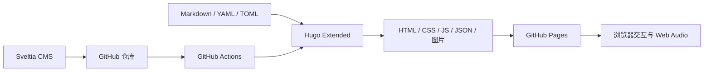

# 北天的个人网站

记录项目、学习与创作的个人博客。首页以黑白点阵全息人物开场，向下滚动进入蓝色背景的内容区；文章、照片墙与仪表盘由 Hugo 生成静态页面。

**[访问网站](https://beitian-xhx.github.io/personal-webpage/) · [内容后台](https://beitian-xhx.github.io/personal-webpage/admin/) · [部署记录](https://github.com/beitian-xhx/personal-webpage/actions/workflows/deploy.yml)**

## 功能

- **滚动入场**：三张透明人物图组成六面点阵结构；静止正对人物，鼠标或触屏横向拖动时转面。周围黑白粒子随音乐与指针流动，向下滚动进入内容区。
- **内容阅读**：项目文章、分类、标签、归档、目录、全文搜索、代码复制、公式与图片放大。
- **交互效果**：背景水彩流动、鼠标反馈、滚动展示，以及首页文章跳转的背景玻璃碎裂。
- **背景音乐**：播放、暂停和音量常驻控制；记忆播放偏好，并在页面间恢复播放位置。
- **个人页面**：关于、照片墙、应用导航、站点地图和统计仪表盘。
- **内容管理**：Sveltia CMS 通过 GitHub 修改源文件，推送后由 GitHub Actions 发布。

## 架构

这是一个静态站点：内容存放在 Git 仓库中，Hugo 在构建时生成页面与索引，浏览器负责交互。GitHub Pages 托管生成结果；站点自身没有常驻应用服务器或数据库。CMS 的 GitHub backend 负责内容读写，不是网站的运行时 API。



| 层 | 实现与职责 |
| --- | --- |
| 内容 | `content/` 中的 Markdown 页面与文章 |
| 结构化数据 | `data/` 中的照片、分类、标签、导航和视觉素材配置 |
| 构建与模板 | Hugo Extended **0.164.0**，项目 `layouts/` 覆盖 `themes/stack/` |
| 客户端 | TypeScript、SCSS，由 Hugo Pipes 编译；WebGL、Canvas、Web Audio 提供效果 |
| 第三方资源 | Three.js、PhotoSwipe、KaTeX 与 Lato 字体的本站托管副本 |
| 发布 | `.github/workflows/deploy.yml` 构建并上传 `public/` |

主题代码随仓库保存，不需要另行安装主题。站点样式在 Stack / Liquid Stack 基础上定制；上游信息见 [主题说明](themes/stack/README.md)。

## 本地运行

安装 **Hugo Extended 0.164.0** 与 Git。普通 Hugo 非 Extended 版本不满足本项目的 SCSS 构建需求。站点的日常运行与构建不需要 `npm install`；TypeScript 和 SCSS 由 Hugo 处理。

在克隆后的仓库根目录执行：

```sh
git clone https://github.com/beitian-xhx/personal-webpage.git
cd personal-webpage
hugo version
hugo server -D --baseURL http://localhost:1313/personal-webpage/
```

打开 **http://localhost:1313/personal-webpage/**。`-D` 用于预览草稿，正式发布时不会包含草稿。

```sh
# 正式构建，输出 public/
hugo --minify
```

日常开发保留 `resources/` 缓存即可，无需每次使用 `--ignoreCache`。`public/` 是生成结果，页面修改应回到源文件完成。

## 目录与修改入口

```text
.
├── hugo.yaml                    # 站点路径、主题、菜单、组件与功能开关
├── content/                     # 文章和独立页面
├── data/                        # 照片墙、导航、分类、标签与资源配置
├── layouts/                     # 项目模板及对主题的覆盖
├── assets/
│   ├── admin/cms-config-base.yml # CMS 配置源
│   ├── ts/                      # 客户端模块
│   └── scss/                    # 项目样式
├── static/                      # 原始图片、音频、后台入口与第三方资源
├── themes/stack/                # 随仓库保存的主题
├── docs/                        # 设计记录、维护说明与第三方许可
└── .github/workflows/deploy.yml  # GitHub Pages 发布流程
```

| 想修改的内容 | 修改位置 |
| --- | --- |
| 站点标题、描述、头像、菜单、组件 | `hugo.yaml` |
| 文章正文与封面 | `content/post/<slug>/index.md` 及对应图片 |
| 关于、应用、归档、搜索等独立页面 | `content/page/`、对应 `layouts/page/` |
| 全站背景与强调色 | `data/site_background.yaml` |
| 点阵人物与六面图片映射 | `data/hologram.json`、`static/img/experience/cube/` |
| 照片顺序、说明与链接 | `data/photo-wall/*.yaml` |
| 资源导航 | `data/resources.yaml` |
| CMS 分类与标签选项 | `data/taxonomies/` |
| CMS 表单与仓库配置 | `assets/admin/cms-config-base.yml` |
| 本站托管的公式和图库资源地址 | `data/external.toml` |

优先在项目的 `layouts/`、`assets/` 中覆盖和扩展主题，便于识别本站改动。已有主题定制仍保存在 `themes/stack/` 中，升级主题前需要逐项对照。

## 内容与 CMS

文章使用 Hugo page bundle，通常为 `content/post/<slug>/index.md`。最小示例：

```yaml
---
title: "项目记录"
slug: project-notes
date: 2026-11-07T12:00:00+08:00
draft: true
description: "这篇文章的简短说明"
categories: []
tags: []
---
```

文章发布路径为 `/p/<slug>/`。发布后保持 `slug` 稳定；完成编辑后将 `draft` 改为 `false`。默认内容语言为中文，现有文章使用 `index.md`。

照片墙每张照片对应一个 YAML 文件，通过 `order` 排序。首页预览与照片墙共用规范化数据和响应式缩略图；原图用于完整查看。分类、标签的 CMS 选项由 `data/taxonomies/` 提供。

后台入口在 `/admin/`。当前 GitHub backend 指向 `beitian-xhx/personal-webpage` 的 `main` 分支，使用 token 登录；凭据通过后台提供，不写入仓库。CMS 操作会修改 GitHub 文件，修改前后注意与本地工作分支同步。

**后台配置由 Hugo 生成**：修改 `assets/admin/cms-config-base.yml` 与分类、标签数据，再重新构建；不要直接编辑生成的 `public/admin/config.yml`。后台 JavaScript 使用固定版本的 Sveltia CMS CDN，后台登录需要访问 GitHub 和相应外网资源。

## 客户端模块

| 模块 | 职责 |
| --- | --- |
| `assets/ts/main.ts` | 主题交互入口，在 DOM 就绪后初始化 |
| `assets/ts/custom.ts` | 站点交互协调，以及菜单、页面与组件交互 |
| `assets/ts/experience.ts` | 开屏、滚动衔接和文章导航的协调 |
| `assets/ts/hologram.ts` | 人物点阵绘制与鼠标反馈 |
| `assets/ts/fluid.js` | 背景流动渲染 |
| `assets/ts/glass-transition.ts` | 背景快照、裂纹与玻璃碎片 |
| `assets/ts/site-audio.ts` | 播放偏好、生命周期、音频分析与能量事件 |
| `assets/ts/audio-field.ts` | 点阵音乐可视化 |
| `assets/ts/site-stats.ts` | 运行天数、活跃统计和热力图 |
| `assets/ts/search.tsx` | 全文查询、排序、高亮与查询状态 |

`main` 和 `custom` 保留 `defer` 顺序；协调代码依赖 DOM 和主题对象就绪。修改启动方式时，应同时检查慢脚本、慢图片和跨页返回。特效参数、着色器与交互节奏集中在对应模块中，数据与加载优化无需改动它们。

## 加载与数据处理

- 人物使用透明背景 WebP，脸、头发和肩部由分层深度表达体积；原人物资源保留。只有实际显示开屏时才预加载三张人物图，普通文章和跳过开屏不加载它们。素材来源见 [人物图片说明](static/img/experience/cube/SOURCE.md)。
- 音乐默认等待人物就绪后尝试播放，用户主动播放可立即启动。浏览器禁止自动播放时，由用户交互解锁声音。
- 播放偏好与音量保存在 `localStorage`，当前标签页的播放位置保存在 `sessionStorage`。跨文档跳转会重新创建播放器，因此存在短暂接续间隔。
- 搜索全文在 Hugo 构建时完成实体解码和换行规范化；浏览器直接读取纯文本索引，同一搜索实例复用一次下载。
- 最近项目和归档复用构建内的文章列表缓存，缓存键包含语言首页路径；新构建会重新生成。
- PhotoSwipe 和 KaTeX 从本站按需加载，字体使用本站 Lato。其他可选组件仍可能使用各自的外部服务。
- 系统启用“减少动态效果”时，页面按现有规则减少或跳过动画。

2026-11-06 的单人物开屏优化，在同一 Edge、冷缓存、2 Mbps 下载和 100 ms 延迟条件下各测两次，首次绘制均值由约 **21.5 秒降至 6.0 秒**。这是旧版渲染器的历史测量；当前三图点阵使用另外的素材与几何，不沿用该数字作为加载成绩。

## 部署与回退

主发布平台为 GitHub Pages，访问前缀为 **`/personal-webpage/`**。资源路径通过 Hugo 的 URL helpers 和页面元数据生成；修改部署位置时同时核对 `baseURL`、CMS URL 和子路径资源。

```sh
# 在完成内容检查与本地构建后，精确暂存本次修改的文件
git add <本次修改的文件>
git commit -m "描述本次修改"
git push origin main
```

推送 `main` 后，GitHub Actions 使用 Hugo Extended 0.164.0 构建，再发布 `public/`。到仓库 Actions 中确认对应提交的部署成功。仓库也保留了 `netlify.toml`，其 Hugo 版本与 Pages 对齐；当前主站以 Pages 流程为准。

回退某次已发布修改时，使用新提交保留历史：

```sh
git revert <需要回退的提交哈希>
git push origin main
```

`params.experience.enabled` 可以关闭增强体验入口，使用保留的普通首页分支；这是功能开关，不等同于回退所有样式和文件。旧版快照的本机恢复工具见历史维护文档，不能代替当前提交的版本管理。

## 维护与许可

- [代码结构审查与维护边界](docs/architecture-review-2026-11-07.md)
- [早期视觉升级与回退记录](docs/2026-10-27-visual-upgrade-guide.md)
- [React Bits 相关许可](docs/third-party/REACT-BITS-LICENSE.md)
- [人物素材生成记录](docs/third-party/portrait-generation.md)

主题许可证见 `themes/stack/LICENSE`；第三方运行库、字体的许可证与来源保存在各自 `static/vendor/`、`static/fonts/` 目录。人物、音乐、图片及文章内容不因本仓库公开而自动获得统一的再分发许可，复用时分别核对其来源和授权。
