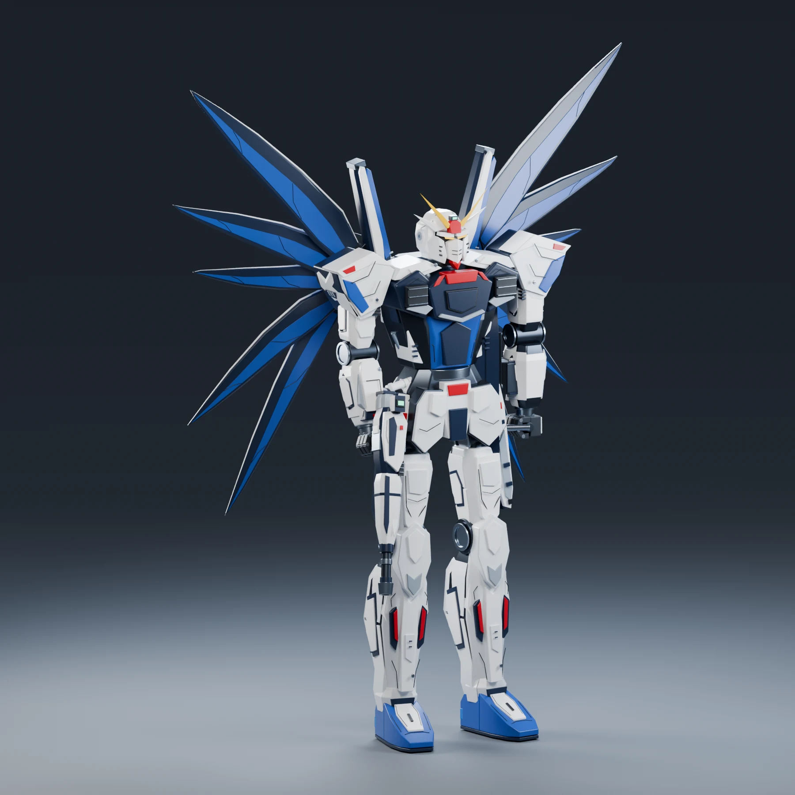
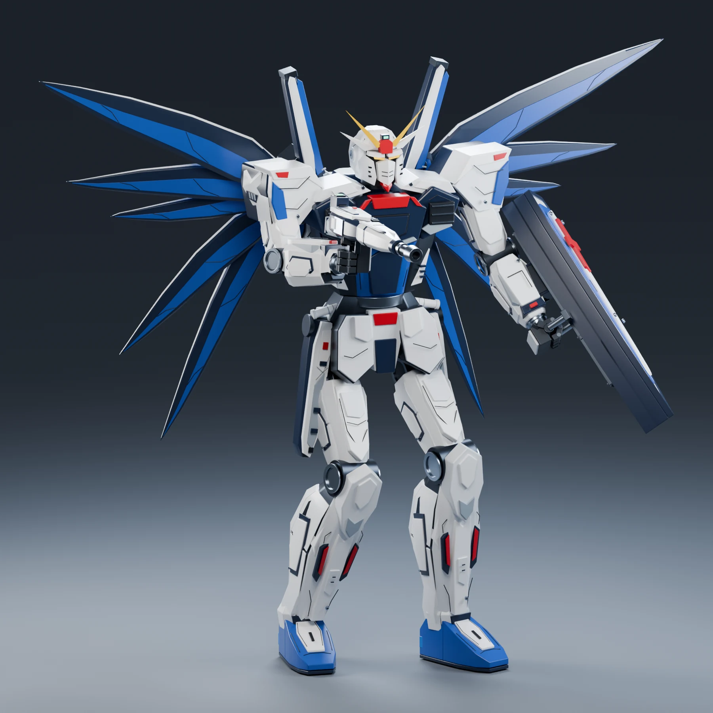
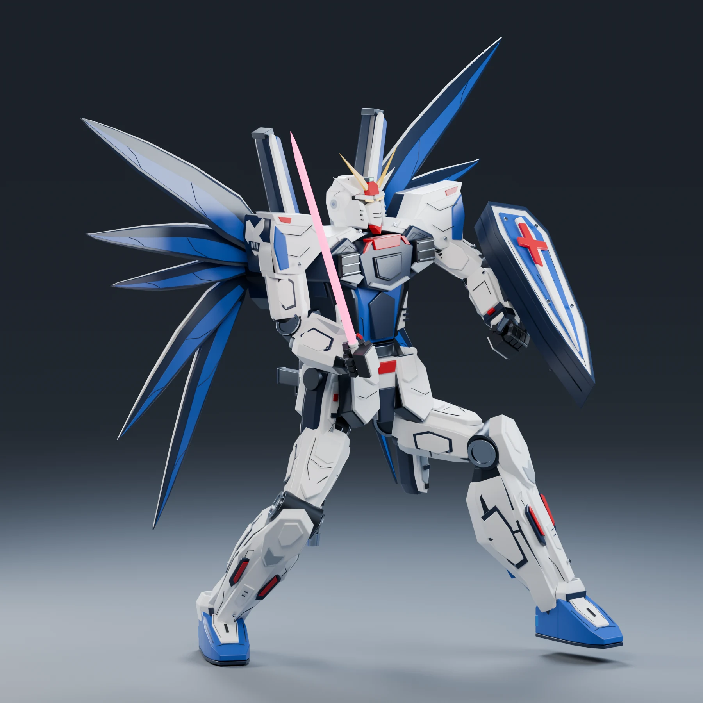
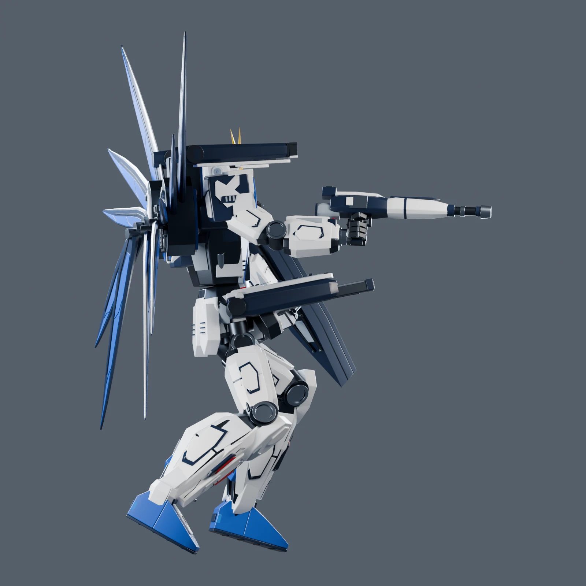
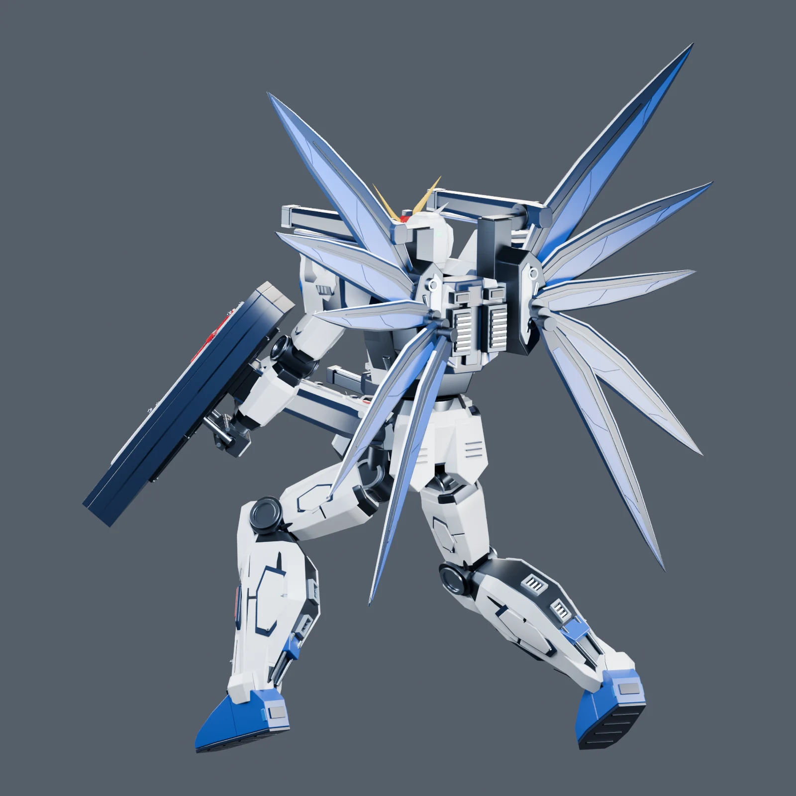

这次重新做了 ZGMF-X10A「自由高达」。目标很具体：展开翅膀时能看清整机轮廓，转到侧后方能看到装甲厚度与连接，换个动作后，手里的武器、身上的装甲和背包仍然跟得住。最后留下一个主模型，以及持枪、持剑、空中全炮三套动作存档，四份都能在 Blender 里继续修改。记录一下这一版的制作过程，工具清单放最后。

本文配图全部从当前 v007 存档重新渲染。文章最初发布于 8 月，本次根据新版模型重写正文并替换图片，网址沿用原来的地址。

## 一、先把参考图的用途分清

机甲建模容易被局部吸引：面罩的几条线、肩甲的切面、翼面上的小结构，都很想立即做出来。但如果头身比例、胸腰关系或腿脚长度还没定，后面每增加一个细节，调整整体时就多一份负担。

这一版先区分了参考的职责。原作资料用于确认自由高达的主要结构和配色；主参考图决定希望呈现的比例与质感；多视图辅助检查侧面厚度、背包位置和部件连接。辅助拆件图用来理解结构，遇到不同视图相互矛盾的地方，仍要回到整机关系判断。

比例调整先从大处开始：头与肩的关系、胸部到腰部的收束、大腿和小腿的长度分配，以及脚尖与脚跟形成的支撑。比如腿部修改时，缩短大腿、延长小腿，同时保持整体腿长，再检查膝关节的位置。这样调整的是身体比例，脚下的落点仍有依据。

另一个有效的检查方法，是暂时隐藏翅膀、盾牌和步枪，只看纯机体侧面。背包很容易遮住胸背单薄的问题，盾牌也会挡住前臂结构。把这些遮挡拿掉后，胸背体积、关节空腔和脚掌厚度才更容易判断。

## 二、装甲细化，先解决体积再处理刻线

这一版的细化集中在几个直接影响观感的位置：头部传感器与面罩、胸肩装甲的分层、前臂和小腿的前后壳、脚尖斜面与脚跟结构，以及背包的翼根和喷口。

主装甲、内层框架、关节和表面细节分别组织。白色装甲需要留出厚度和转折；深色结构负责表现装甲之间的空隙与连接；蓝色翼面则通过长宽比、逐渐收尖的轮廓和颜色分区形成层次。先把这些体积做出来，刻线和小零件才有合适的位置。

黑色面板线也调整过。线条过粗，或者离装甲表面太远，远看就像额外贴了一根杆。处理时先让线贴合装甲，再控制粗细和密度。翼面的处理同样如此：根部怎么接、展开后的轮廓是否清楚，比继续往表面加小零件更影响效果。

材质保留白、蓝、深蓝、红、金黄和深灰之间的清晰分区。渲染时用灯光把装甲斜面和边缘照出来，让整机轮廓在缩小后仍然可读。

## 三、让硬表面部件跟着骨架走

造型完成后，下一步是让它可以继续摆动作。当前骨架对象叫 `RIG-FREEDOM`，包含 **30 根骨骼和四条四肢 IK 链**。手脚有目标控制，肘膝有方向控制，腰、胸、头和部分装甲也有各自的控制点。

机甲装甲采用刚性跟随：部件随对应骨骼移动，网格本身保持形状。这里需要处理的不只是手臂和小腿；髋部连接套要跟骨盆，颈部连接要跟胸部，武器与盾牌也要落在明确的装配关系里。换父级时保留部件的世界位置，再检查动作后的结果，避免初始站姿看起来正确，一转身就露出偏移。

四条 IK 链都关闭了伸展。拖动手腕时，上臂和小臂联动；拖动脚踝时，大腿和小腿联动。目标移得太远，肢体会伸直，到达自身长度的限制。肘膝的黄色方向控制点负责决定弯向，尤其在手臂或腿接近伸直时，需要给求解器明确的方向。

操作上把控制分成几组：红色对应机体右侧，蓝色对应左侧，黄色菱形用于肘膝方向。常用手腕控制叫 `CTRL-hand.R` 和 `CTRL-hand.L`，脚踝控制叫 `CTRL-foot.R` 和 `CTRL-foot.L`。打开存档就能进入姿态模式，用 **G** 移动、**R** 旋转，继续调整动作。

武器装配先对齐抓握位置，再检查手指与握把的关系。右腕可以独立转向，枪和光剑随手掌调整；左盾同时受到前臂和抓握关系约束，因此左腕朝向随前臂固定，调盾时主要移动左手目标、改变左肘方向。

## 四、用四份存档保留动作

这一版最终保留了四份独立的 `.blend` 文件：

| 存档 | 用途 |
|---|---|
| `freedom_rigged_master_v007.blend` | 主模型与中性站姿，适合改造型或开始新动作 |
| `freedom_rifle_aim_v007.blend` | 持枪瞄准，检查武器抓握与地面站位 |
| `freedom_saber_guard_v007.blend` | 持剑迎战，步枪挂在后腰 |
| `freedom_himat_full_burst_v007.blend` | 空中全炮展开，展示翼面与武器部署 |

把动作分别存下来，下一次修改就能从选中的姿势开始。已经手调好的身体倾角、手脚位置和武器朝向都留在文件里，不需要先运行脚本重新生成一套预设。

翅膀和武器展收集中在 `ARM-FREEDOM` 的自定义属性中：`wing_fold` 从 0 的完全展开到 1 的收拢；`weapons_deploy` 从 0 的收起到 1 的全炮展开。肩炮沿支架外移、升降，腰炮的伸缩段随部署状态显示。身体动作和背包展收可以分别调，再从侧面检查它们有没有互相遮挡。

肩甲、前裙甲和后裙甲有独立控制，方便在抬腿、转身后做避让。大幅动作仍需要人工检查装甲穿插，目前没有自动避碰。我的操作顺序是先摆身体和手脚，再调肘膝方向，最后处理装甲与武器的位置。

## 五、验证模型，也验证渲染流程

交付时重新打开了四份模型，检查几何、材质分配和骨骼姿势；每份都没有外部链接库或纹理图片依赖。骨架控制也做过实际测试：在内存里移动右手 IK 目标，检查手臂响应与骨长，再恢复原动作，测试结果不写回模型。

本次重新打开文件统计，主模型、持枪和全炮场景各有 **886 个网格对象**，持剑场景为 **893 个**。这些是整个场景中的网格对象数，其中包含展示与控制辅助对象，不能直接当成独立机械零件数量。

渲染从当前存档读取姿势，只调整相机、地面和输出设置。取景使用应用修改器和依赖图后的几何，先把模型坐标投影到相机空间，再居中并留出余量。展开的翼尖、伸出的炮口和脚部都要纳入画面。

本次文章图片使用 Blender 的 Cycles 渲染，采用 AgX 色彩管理与降噪。渲染前后对比骨骼姿态、部件世界矩阵和展收属性，并核对源文件哈希，确认拍图没有改变模型。正文图片另外压成 WebP，保留原始 PNG 作为制作记录。

这套成果定位为可编辑的三维展示模型。继续摆姿、修改装甲和重新渲染都从 `.blend` 开始；若要制作实体，还需要另做壁厚、连接和支撑设计。

## 六、整体流程与工具清单

这一版的流程是：**参考分工、整机比例、侧面体积、装甲分层、刚性绑定、IK 与展收控制、动作存档、多视角检查、渲染发布**。

造型修改优先从主模型开始，动作修改从对应存档开始。调整后另存编号；渲染脚本只负责读取和拍图。这样重新出图时，可以明确知道使用了哪份模型、哪套姿势。

| 工具 | 用途 | 官网链接 |
|---|---|---|
| Blender 4.5 LTS | 装甲造型、材质、骨架、IK、姿势编辑与场景保存 | [Blender](https://www.blender.org/) |
| Blender Python API | 部件组织、绑定与装配辅助、相机取景和验证 | [Python API](https://docs.blender.org/api/4.5/) |
| Cycles | 文章配图与多视角渲染 | [Cycles](https://www.blender.org/features/rendering/) |

回头看，这次重做花得最值得的时间，是把比例、装甲连接和姿势控制逐项整理清楚。站姿确定造型，动作检验装配，多视角渲染帮助发现遗漏。后续继续补动作时，也会沿用当前四份存档和这套检查方式。
