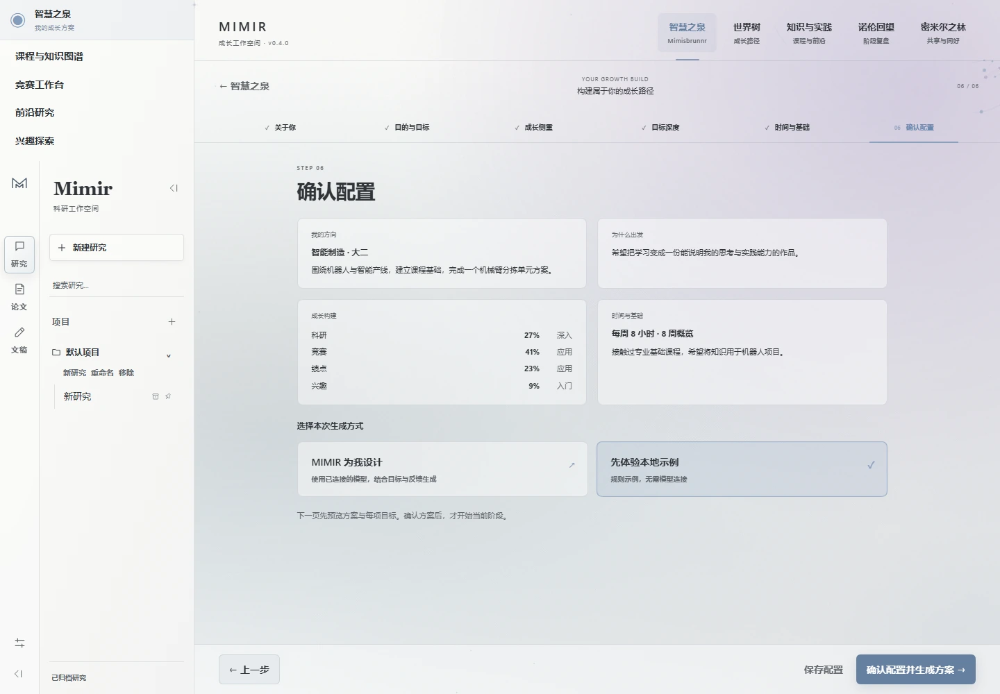
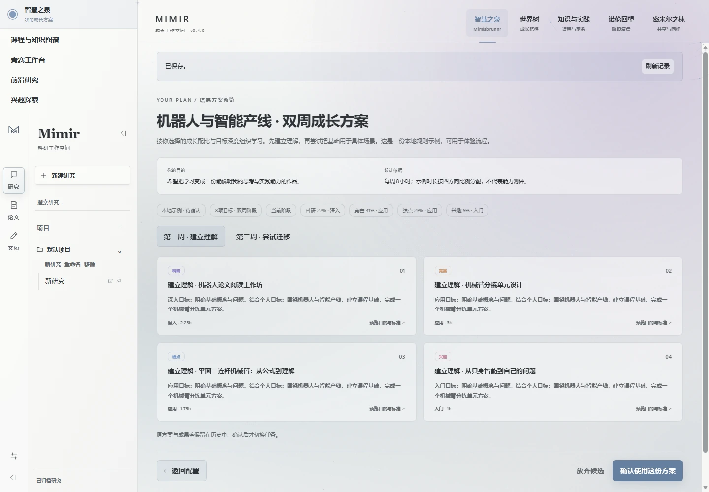
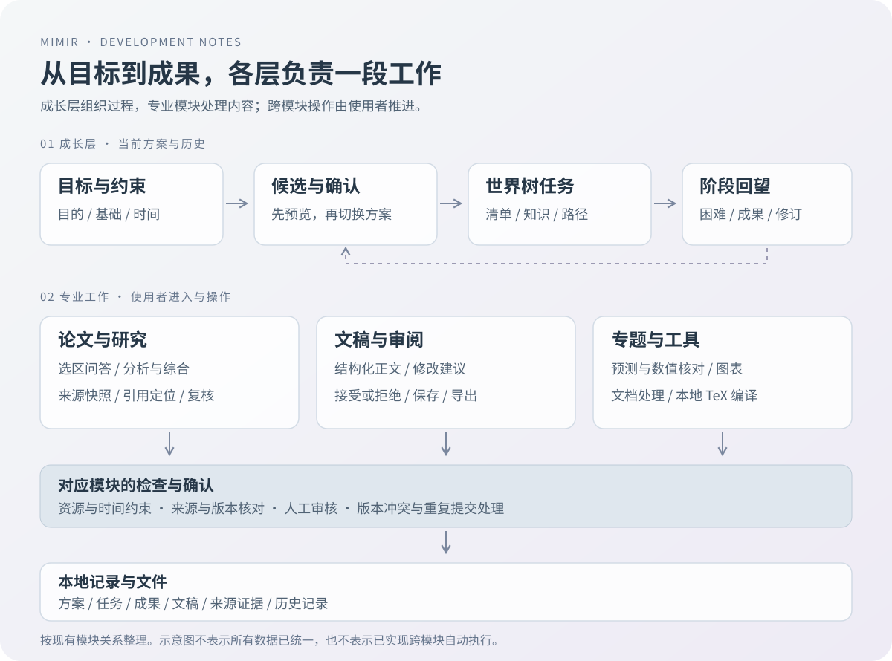
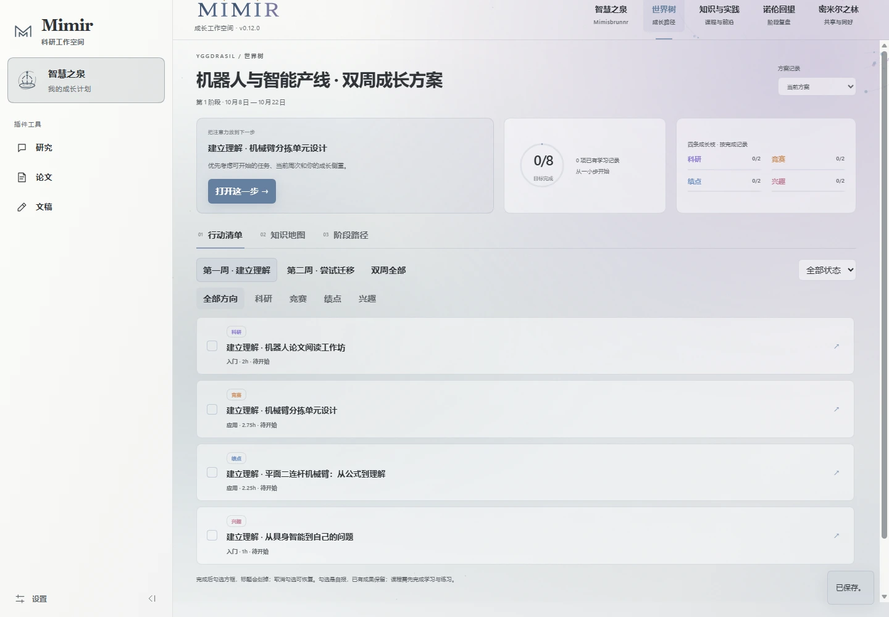
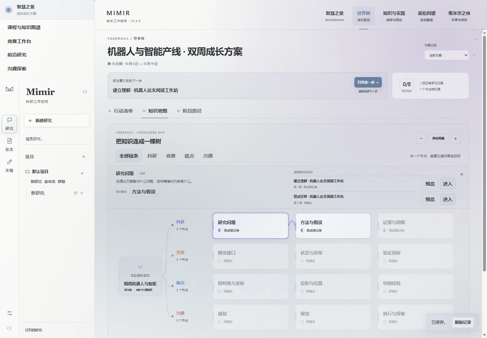
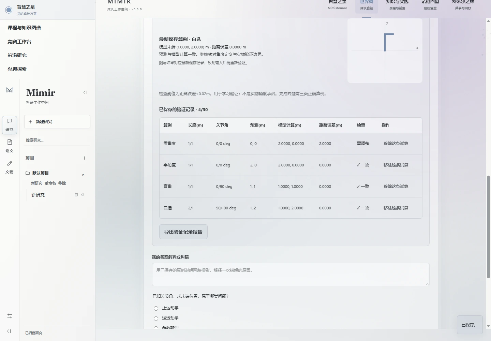
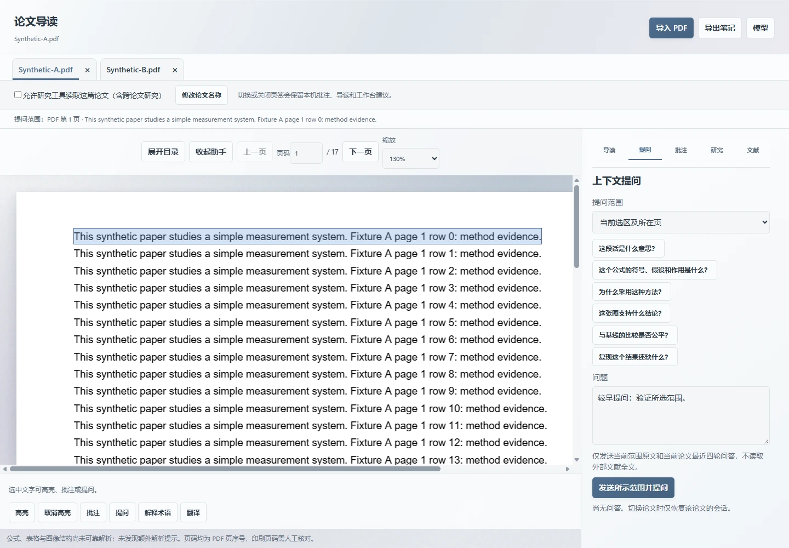
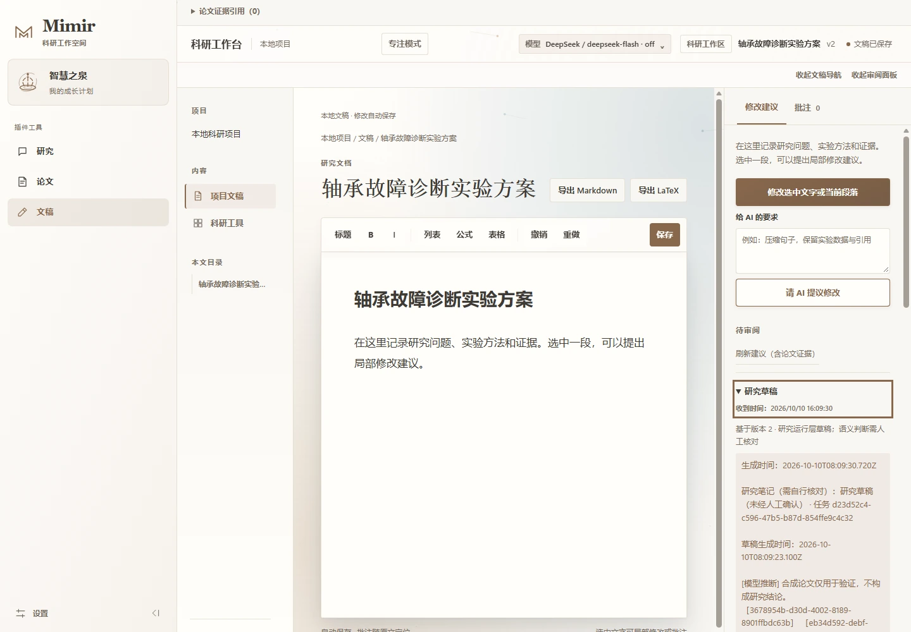
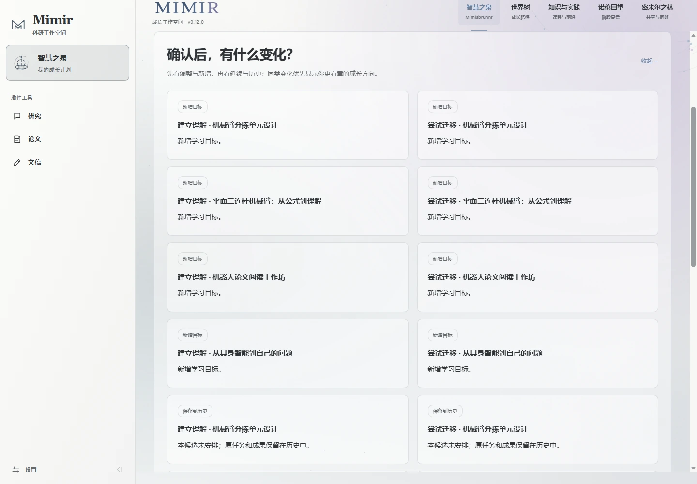

最近一直在做 Mimir，中文名叫「智慧之泉」。它最早是一个本地科研工作台：在一个地方讨论问题、读论文、写文稿，调用工具生成文件。后来往前多想了一步——如果使用者还不知道该读哪篇论文、先补什么基础、怎样把一个大目标拆成今天能做的事，这个工作台应该怎样接住他？于是又加上了成长配置、课程实践、任务路径和阶段回望，首个具体方向选了智能制造里的机器人与智能产线。

这篇把两段开发过程一起记下来：先说明它能怎样使用，再展开几个真正花过心思的地方。工具清单放最后。

*文中界面图来自开发与验收时保留的真实截图，包含本地示例和合成论文，不代表真实学生的学习成果。不同截图对应不同迭代；功能与验证范围以正文标注的版本为准。本文整理于 2026 年 10 月 18 日，最近核对的成长层版本为 0.12.10。*

## 一、从「工具放在一起」到「事情接着做」

最初的需求比较直接：读论文时可以问问题，整理思路时可以写东西，计算、绘图和文档处理也能在同一个工作空间里进行。前期先把研究、论文、文稿三个入口做出来，底层沿用 DSHRC2 的宿主与 Agent 能力，再补文档服务、论文来源、科研运行层和专业工具。

用起来之后，更具体的问题出现了：一次问答结束，下一步做什么？论文里找到了一个想法，怎样变成文稿里的可审阅建议？改了学习方向，原来的任务和成果要放在哪里？这些问题决定了后来的产品结构。

Mimir 的两层分工逐渐清楚了：

| 层次 | 负责的事情 | 使用者留下的内容 |
| --- | --- | --- |
| 成长层 | 明确目标、组织任务、安排练习、根据反馈提出下一步 | 当前方案、任务过程、成果、自评和历史 |
| 科研工作层 | 研究探讨、论文导读、来源定位、文稿修订与工具执行 | 阅读记录、研究草稿、修改建议和导出文件 |

成长层把入口和成果组织起来，专业模块完成各自的工作。当前这些模块主要由使用者主动进入、操作和确认；成长方案还不会自动替使用者操作所有界面，也不会读取没有提供的附件。

开发脉络可以分成几个阶段：

| 阶段 | 主要变化 | 当时要解决的问题 |
| --- | --- | --- |
| 科研工作台阶段 | 结构化文稿、论文导读、建议审核、科研工具 | 内容怎样保存，AI 建议怎样进入正文 |
| 2026-10-04，Windows Beta | 交付 0.12.0-beta.1 整包 | 换到收件人的使用环境，是否仍能启动和生成真实文件 |
| 成长层阶段 | 六步配置、世界树、课程与知识图谱、诺伦回望 | 怎样从一个宽泛目标走到可执行任务 |
| 2026-10-11，成长层 0.12.10 | 保留功能修补，恢复原生提供商与模型配置 | 配置选择能否贯穿实际调用，历史资料是否继续保留 |

这里的 Windows Beta 和成长层是不同交付阶段，各自的版本与测试结果需要分开看。

## 二、先把输入和状态整理清楚

### 1. 六步配置：目的、侧重、深度、时间各有位置

学习规划很容易变成一张长表单，填完之后得到一段宽泛建议。Mimir 后来把配置拆成六步：关于你、目的与目标、成长侧重、目标深度、时间与基础、确认配置。先给可选项，需要补充时再展开自由输入。



这里有几个容易混在一起的量：科研、竞赛、绩点、兴趣表达投入方向；入门、应用、深入表达想走多远；每周可用时间是独立约束。同样偏向科研，每周两小时和八小时能安排的任务量不同；同样投入八小时，了解一个方向和完成一份分析报告也需要不同安排。

因此这些输入分开保存，生成候选后再检查任务和时间是否合适。默认路径提供八周概览，但当前执行重点放在两周，第七天轻回顾、第十四天阶段复盘。确认时记录真实日期，后续回望才能对应到实际经历。

最后一步还把「Mimir 为我设计」和「先体验本地示例」明确分开。前者需要连接模型，后者使用本地规则示例。模型失败会显示错误，不会悄悄切换成示例结果，让使用者误以为这就是刚才的 AI 输出。

### 2. 候选方案先预览，确认后才生效

方案里每项任务都需要说明目的、预期成果和完成标准。使用者可以先看任务，再决定采用，或者返回修改配置。



实现上，候选先保存为 `draft`。确认后，它成为当前方案，原方案转入历史，其他旧候选失效。失败、取消、超时和格式不合要求的结果，都不能切换当前方案。

任务需要引用资源目录里已有的资源 ID，还要与所选方向对应。课程、论文、竞赛和兴趣各有自己的内容与完成标准，模型不能临时编一个课程链接来补齐任务。这让「生成方案」有了具体的业务约束。

### 3. 学习记录要能承受重复点击和过期结果

成长数据使用 SQLite，写入同时检查版本号和请求键。版本号防止旧页面覆盖新内容；请求键处理重复提交。同一个请求再次到达时返回原结果，同一个键带着不同内容则拒绝。

模型调用比较慢，所以等待模型期间不会一直占着数据库写事务。返回后再检查一次版本：如果使用者已经改了配置，旧结果就不能照着调用前的状态落地。

这件事在聊天界面里不显眼，但对一个会保存方案、任务和成果的工具很关键。重复点击、开两个页面、生成过程中改配置，都属于正常使用会遇到的情况。

## 三、核心实现：把建议变成可以检查的工作



### 1. 世界树：同一份方案，三种观察方式

世界树有行动清单、知识地图和阶段路径三个视图。清单回答「接下来做什么」，知识地图展示这份方案实际涉及的概念，阶段路径帮助理解任务安排。





地图中只放当前方案真正使用到的资源与概念，避免为了视觉丰富画出一棵与任务无关的大树。节点状态来自相关任务记录，也保留了一个边界：勾选自查、提交成果、确认完成是不同动作，任务完成记录不能直接推断为知识已经掌握。

任务可以记录下一步、简记和卡点，进入完整学习页后继续填写过程与成果。快速保存和完整学习共用每任务草稿，避免两个入口各存一份、来回覆盖。

### 2. 运动学专题：先预测，再用计算核对

第一个往深处做的专题是平面二连杆机械臂。它的范围比较清楚，输入与结果也能独立核对，适合用来检查学习流程是否成立。

专题分为三段：先修检查，算例预测与验证，应用解释与分析报告。先确认三角函数、角度与弧度、相对角等基础，再填写预测坐标，随后才查看模型计算与图示。

计算使用理想平面刚性模型：

```text
x = L1 × cos(θ1) + L2 × cos(θ1 + θ2)
y = L1 × sin(θ1) + L2 × sin(θ1 + θ2)
```

第二个关节角相对第一根连杆，所以第二段投影使用 `θ1 + θ2`。这个定义很容易弄混，也正好能通过算例说明。两根连杆长度都为 1 米时：

| 第一关节角 | 第二关节相对角 | 末端位置（米） |
| --- | --- | --- |
| 0° | 0° | (2, 0) |
| 90° | 0° | (0, 2) |
| 90° | 90° | (−1, 1) |



后端重新计算关节点、末端位置和欧氏距离误差，客户端提交的「通过」、算例类别或坐标不会直接成为结果。练习阈值是 0.02 米，仅用来检查预测是否接近理想模型，不表示实物机械臂的定位精度。

完成专题还需要先修检查、零角度／直角／自选输入三类成功算例、课程问答和成果条件。短时间做完一个小步可以保存，整项目标仍按它自己的条件确认。撤回完成时保留原有验证记录，方便继续修改。

这段实现带来的收获很具体：AI 可以解释、追问和反馈，数值结果交给确定的计算，学生再解释为什么出现这个结果。报告里因此能留下输入、预测、计算和修正依据。

### 3. 论文阅读：回答旁边要有能回去看的原文

论文模块支持导入 PDF、切换多篇论文、选区问答、批注和来源定位。选区提问时，高亮会在输入问题和点击其他位置后保留；发送后再清除，问题标题与原文选区分别保存。



研究运行层读取的是宿主提供的论文快照。证据关联论文身份、版本、来源哈希、解析版本、页码和原文片段。模型返回引用编号后，系统检查编号是否存在、引文能否在原文定位、来源是否仍与任务快照一致。

研究流程按分析、综合、复核和有限修复组织。复核指出问题后最多进行一次修复，结果继续保留草稿性质。来源存在和文本定位可以做确定性检查；原文是否充分支持某个结论，仍需要语义判断与人工核对，两类检查在结果里分别表达。

跨论文比较还有一个实际问题：同样写着「准确率」，数据集、指标定义和实验协议可能不同。Mimir 会核对这些比较条件。条件不一致或未知时，后续处理保留有引用的单篇陈述，并说明无法直接排名的限制。即使所声明的条件相同，也不能据此认定科学上完全可比。

### 4. 精简上下文：原文只传一次，证据保留定位

开发中有一次研究任务包含 59 页、193,743 字符解析正文和 3,088 条证据，完整请求却达到 1,945,133 字符。原因是原文、逐字引用、来源哈希和定位信息被重复装进请求。

后来增加了 `compactResearchRequest()`：每页原文完整传一次；每条证据改为短引用编号、页码、原文起止位置和可靠性状态。完整来源信息仍保留在本地快照，用于核对与回跳。

```text
页面：{ page, text }
证据：{ citationId, page, start, end, confidenceState }
```

模型返回后，只把引用字段中的短编号还原成完整编号，正文、问题和标题保持原样。未知编号不会被转换成一个看起来合法的引用，仍交给后面的校验拒绝。

同一任务的请求从 **1,945,133 字符降到 475,100 字符，减少 75.57%**，页面和证据全部保留。这是一次本地请求大小与引用往返检查，不能直接换算为同样比例的 Token、费用或速度收益。

这里还有一个小细节：起止位置按 JavaScript UTF-16 索引计算，重复引文、中文和表情都需要检查。否则请求虽然变短，回到原文时却可能指错位置。

这次还修了错误传递：原先模型层已经区分的错误，被研究层统一覆盖成了「处理未完成，请检查模型设置或连接」。后续保留可信的脱敏错误类别，让授权、容量、超时和输出不完整分别显示原因。旧错误没有保留下来的供应商信息，也没有事后猜成一个确定原因。

### 5. 文稿修改：建议、接受、保存各自有约束

文稿工作台使用 React、TypeScript 和 Tiptap，支持结构化正文、标题、列表、表格、公式、批注，以及 Markdown 和 LaTeX 导出。段落使用稳定 ID，便于定位建议和批注。



AI 修改先进入建议区，使用者对照原文后接受或拒绝。底层文档服务会核对目标文档、基础版本和差异摘要，再使用短时、一次性的授权应用修改。建议生成之后，如果正文已经发生变化，就需要重新检查，避免把旧建议盖在新内容上。

文档变更、审计记录、待发布事件和幂等结果在同一事务中保存。模型可以提出建议，但不能自己生成应用建议所需的用户授权。

这里也保留了实现范围：核心建议通道对段落结构有约束，不能任意修改所有富文本内容。稳定段落 ID 同样不能解决所有批注重定位问题；正文变化后，找不到原范围的批注需要标记失效，不能挂到别处继续显示。

### 6. 回望与复用：改计划时，先解释哪些地方变了

阶段回望收集目的变化、困难和下一步选择，再生成候选。使用者能查看调整、新增、延续和历史内容，然后决定是否采用。



内容一致的任务可以延续已有成果，替换掉的任务留在历史里；旧成果不会直接算作新任务已完成。课程专题升级也需要单独确认，避免更新一套完成规则，就让原来保存的学习过程失去意义。

方案库支持 JSON／Markdown 导出、JSON 导入与重新适配。导入内容先校验允许字段、按内容指纹去重，再结合新的基础和时间预览。这个阶段的收藏和论坛数据保存在本机目录中，还没有跨用户在线社区。

## 四、交互与交付：在开发机跑通之后，还要继续往下查

### 1. 界面要给内容留出位置

早期科研页面有很多面板，研究、目录、正文、审阅各占一块。后来主要做了收敛：项目目录、论文目录、助手与审阅面板分别折叠，长内容各自滚动，让读论文和写正文时可以留出足够空间。

成长配置也从长表单改成分步进入。首页只给主要入口，细节到对应页面再展开。浅色和深色全局一致，空间色调可以区分；背景粒子和曲线放慢，避免影响选字、阅读与输入。

这些调整的价值往往出现在连续操作里：折叠后再打开，草稿和阅读位置是否还在；翻页或缩放之后，选区和定位是否稳定；窄屏下，长表单底部是否真的能滚到。

### 2. Windows 整包：把运行环境也当成交付内容

前期以插件方式开发，后面要交给合作伙伴测试，安装要求就得收起来。2026 年 10 月 4 日的 0.12.0-beta.1 Windows 包内置 Node.js、CPython、科研与 PDF 依赖、MiKTeX 和对应许可证，解压后由 `Mimir.exe` 启动。

当时 ZIP 为 **983,187,761 字节，包含 64,079 个文件**，内置 59 个 Python 依赖包。包体比较大，主要取舍是让收件人使用本地阅读、文档和 TeX 能力时，不再临时安装一套运行环境。

整包验证使用独立合成资料和数据目录，启动时先把 PATH 缩到 Windows System32，再看产品能否找到自己的运行时。中文和空格路径、中文 TeX 文件名、文件下载、正常退出与重启都进入检查范围。

实际生成并核对过的产物包括 Word、Python／Pandas 计算结果、PNG／PDF／SVG 图表，以及中文 XeLaTeX PDF。文稿导出也读取当前编辑快照，核对下载内容是否包含最新正文。

这里出现过很具体的问题：中文 TeX 输出名不合法、冷启动检查误走旧的联网安装分支、随机页面端口让重启后的外观偏好丢失。修复都围绕交付路径处理——规范输出名、固定选择包内运行时、优先复用页面端口。

### 3. 模型配置最终要走到真实调用里

成长层中间曾限制到固定提供商，0.12.10 又恢复了 DSH 原生的提供商和模型配置。使用者可以进入原生编辑器，配置符合 OpenAI Chat Completions、OpenAI Responses 或 Anthropic Messages 协议的接口，再保存实际选择。

验证时检查的不只是下拉框内容，还包括对话、标题生成和一次质量修正是否使用所选模型。密钥交给原生凭据服务保存，页面不回显旧 Key；学习数据库和交付包不承担密钥保存职责。

资料在本机组织，在线模型调用仍会按当前配置发送任务所需内容，因此本地工作空间和离线 AI 是两回事。模型上下文容量、外部接口行为和实际费用，也继续取决于使用者选择的服务。

### 4. 测试记录要能说明它到底证明了什么

项目保留了单元检查、实际宿主接口、浏览器操作、导出文件和重启恢复记录。它们对应不同问题，不能只用一个通过数量概括。

| 版本与日期 | 已有记录 | 能据此说明的范围 |
| --- | --- | --- |
| 科研工作台 0.12.0-beta.1，2026-10-04 | 323 项自动检查；真实包内工具生成文件；界面与持久化复验 | 本机整包的对应功能与交付路径 |
| 成长层 0.12.2，2026-10-08 | 请求精简与引用往返检查；108 项单元检查；合成 PDF 场景 | 输入组织、引用还原和错误传递；模型请求使用本地模拟服务 |
| 成长层 0.12.10，2026-10-11 | 276 项单元检查；46 个覆盖文件核对；5 项实际界面检查；3 次本地模拟调用 | 原生提供商配置与实际适配链路；未逐一付费验证外部服务 |

这些是当时保留的工程记录，本次整理文章没有重新运行 Mimir 全套验收。它们也不等于成绩提升、用户满意度或商业收益，目前没有足够的真实学生试用数据来作这类结论。

仍需要继续补的部分也比较清楚：第二台干净 Windows 机器验收、真实使用反馈、部分批注与文件操作的恢复流程。扫描 PDF 还没有内置 OCR，研究任务中断后不会自动续跑；多用户身份与在线社区也需要额外建设。早期 Beta 和后续成长版的完成范围不同，需要按版本看。

## 五、整体流程与几条留下来的工程约定

从使用过程看，一次任务可以这样推进：

1. 填写目的、基础、侧重、深度与时间，预览并确认方案。
2. 从世界树选定任务，进入课程实践、论文阅读或研究工作。
3. 保存预测、验证记录、阅读笔记和成果草稿。
4. 对照来源审阅 AI 建议，需要时接受修改并导出文件。
5. 记录困难与下一步选择，预览修订，保留已有历史再继续。

这条流程背后，几条约定一直在起作用：

- **模型负责提出候选。** 资源、时间、来源、版本和完成条件仍由对应业务规则检查。
- **内容有稳定身份。** 任务、段落、论文版本和证据需要能互相定位，才能解释一条建议从哪里来。
- **慢操作之后重新检查状态。** 模型返回时，调用前的版本可能已经过期。
- **生成与采用分别记录。** 方案生成、成果提交、完成确认和文稿接受各有自己的动作。
- **构建产物也要核对。** 科研前端修改后先构建工作台，再构建 bundle，避免打包成功却装入旧界面。
- **交付检查读取真实内容。** 下载成功之后打开文件，重启之后再读状态，确认结果确实留下来了。

这些约定比某个具体页面更容易复用。后面换一个学习主题，入口和内容会变，任务、证据、候选与确认的关系仍然可以保留。

## 六、工具清单

| 工具／组件 | 在 Mimir 中的用途 | 官网或项目入口 |
| --- | --- | --- |
| DSHRC2 | 宿主、Agent 生命周期、模型适配、原生设置与凭据基础 | 复用项目已有运行基线 |
| Node.js | 本地服务、SQLite 接口、构建与任务运行 | [nodejs.org](https://nodejs.org/) |
| React / TypeScript | 科研工作台界面与类型约束 | [React](https://react.dev/) / [TypeScript](https://www.typescriptlang.org/) |
| Tiptap / ProseMirror | 结构化编辑、段落与选区处理 | [Tiptap](https://tiptap.dev/) / [ProseMirror](https://prosemirror.net/) |
| MathLive | 文稿公式输入 | [cortexjs.io/mathlive](https://cortexjs.io/mathlive/) |
| SQLite | 文稿、成长状态、请求幂等与事件记录 | [sqlite.org](https://www.sqlite.org/) |
| Python / Pandas | 文件处理与数据计算 | [Python](https://www.python.org/) / [Pandas](https://pandas.pydata.org/) |
| MiKTeX / XeLaTeX | 本地中文与公式 PDF 编译 | [miktex.org](https://miktex.org/) |
| arXiv API | 按已注册方向获取论文元数据与摘要 | [arXiv API](https://info.arxiv.org/help/api/index.html) |
| pnpm / Vite | 工作区依赖管理、前端构建与打包 | [pnpm](https://pnpm.io/) / [Vite](https://vite.dev/) |

本文主要依据两个阶段的 README、核心源码与对应验收记录整理，包括成长层的 `architecture.md`、`robotics-topic-2026-10-07.md`、`research-model-2026-10-08.md`、`provider-restoration-2026-10-11.md`，以及科研工作台的文档服务实现和 `WINDOWS_BETA_ACCEPTANCE_0.12.0-beta.1.md`。正文中的数字沿用对应记录的日期与口径。

回头看，Mimir 里最有价值的积累，是把一段 AI 对话接到后续工作的方法：目标进入任务，任务留下过程，建议附带来源，采用之后保存结果，下一次再从这些记录继续。接下来更值得做的是选定专业主题、收集真实使用反馈，把已有流程做扎实，再决定向哪些方向扩展。
